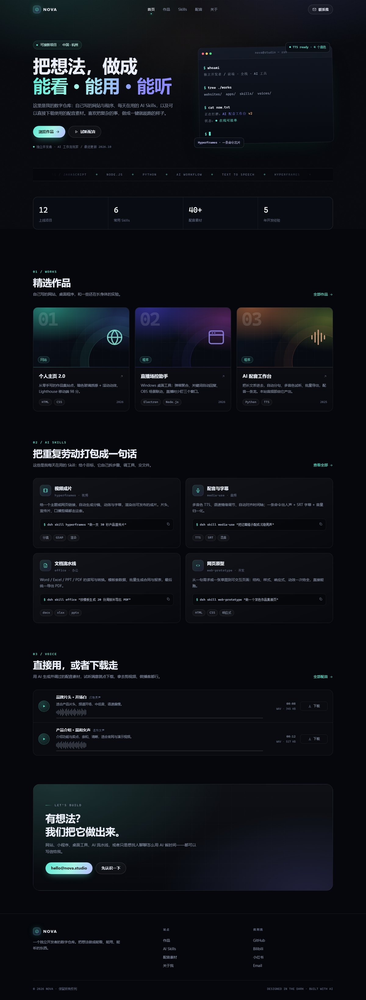

# 小佑 · 个人作品与 AI 实验室

一个纯静态、零依赖的个人网站：展示自己做的网站与程序、日常在用的 AI Skills，以及可以直接试听、下载的配音素材。

**线上地址：** https://a532354181-del.github.io/



## 包含哪些页面

| 页面 | 文件 | 内容 |
| --- | --- | --- |
| 首页 | `index.html` | 主视觉、数字统计、精选作品、Skill 摘要、最新配音、联系入口 |
| 作品 | `works.html` | 全部项目，可按「网站 / 程序 / 实验」筛选 |
| Skills | `skills.html` | 6 个 AI Skill 卡片、调用命令（可一键复制）、工作方式说明 |
| 配音 | `voice.html` | 试听、进度拖动、下载 MP3，附使用许可说明 |
| 自我介绍 | `intro.html` | 资料卡、长版自我介绍、「我在做的事」 |
| 关于 | `about.html` | 简介、最近在忙、时间线、联系方式 |

## 本地打开

直接双击 `index.html` 就能看，不需要 Node、不需要构建、不需要联网（字体使用系统字体）。

想用本地服务器也可以：

```powershell
cd portfolio
python -m http.server 8000
# 打开 http://localhost:8000
```

## 所有内容都在这一个文件里

`assets/js/data.js` 是整站唯一的内容源，改完保存、刷新浏览器即可。

### 字段速查

**profile（站点与个人信息）**

| 字段 | 说明 |
| --- | --- |
| `brand` | 左上角 Logo 文字（页头、页脚同步） |
| `name` | 你的名字 / ID |
| `role` | 身份描述，如「独立开发者 · AI 工作流玩家」 |
| `email` | 邮箱；页面里所有写信按钮都会自动指向它 |
| `location` / `available` | 首页徽标里的地点与接单状态 |
| `headline` | 首页大标题，支持 HTML（`<br>`、`<span class="grad">` 渐变字） |
| `lead` | 首页介绍段落 |
| `socials` | 社交链接数组，页脚与关于页自动生成 |
| `stats` | 首页四个数字，`40+` 这类带后缀的写法也能正确显示 |
| `now` | 关于页「最近在忙」列表 |
| `intro` | 自我介绍页：`title` 标题、`lead` 正文、`facts` 左侧资料卡 |
| `doing` | 自我介绍页「我在做的事」三张卡片 |
| `about` | 完整自我介绍（自我介绍页 + 关于页），数组里每条是一段 |

**works（作品）**

| 字段 | 说明 |
| --- | --- |
| `type` | 只能是 `网站` / `程序` / `实验`，筛选按钮由它自动生成 |
| `hue` | 封面色相 0–360：170 青绿、245 紫、25 橙、145 绿 |
| `icon` | `globe` `app` `wave` `layers` `terminal` `chart` |
| `featured` | `true` 才会出现在首页「精选作品」 |
| `link` | 站内页面（如 `voice.html`）或 `https://` 外链，自动加 `target="_blank"` |
| `year` / `tags` | 卡片右下角年份与标签（最多显示 2 个） |

**skills（AI Skills）**

`name` `en` `category` `icon` `desc` `snippet` `tags`。
`snippet` 会显示成终端命令，右上角有复制按钮。可用图标：`film` `mic` `doc` `code` `spark` `table`。

**voices（配音）**

`title` `voice` `desc` `duration` `size` `format` `file` `tags` `wave`。
`wave` 只是波形示意图，30 个 4–30 的数字，随便改不影响播放。

### 换成自己的内容

1. **改身份**：`data.js` 顶部的 `profile`，至少换掉 `brand`、`name`、`email`、`socials`。
2. **改作品**：编辑 `works` 数组，或复制一条新增。序号、筛选、首页精选都会自动更新。
3. **改 Skills**：编辑 `skills` 数组，命令示例按你的真实用法写。
4. **换配音**：把音频文件放进 `assets/audio/`，再把 `file` 改成相对路径，同时更新 `duration`（如 `00:42`）、`size`、`format`。支持 MP3 / WAV / M4A，浏览器能播的都能用。
5. **改页面标题与 SEO**：每个 HTML 的 `<title>` 和 `<meta name="description">`。
6. **改配色**：`assets/css/style.css` 顶部 `:root`，重点改 `--bg`、`--accent`、`--accent-2`。
7. **换图标**：替换 `assets/img/favicon.svg`。

> 全站出现「小佑」的地方还可以直接全局查找替换；Logo 文字已绑定 `profile.brand`，改一处即可。

### 新增一条作品（可直接复制）

```js
{
  id: "my-new-app",
  title: "项目名",
  summary: "一句话说清楚它解决什么问题。",
  type: "程序",              // 网站 / 程序 / 实验
  year: "2026",
  hue: 210,
  icon: "app",
  tags: ["React", "Supabase"],
  link: "https://example.com", // 或站内页面，如 "voice.html"
  linkLabel: "查看项目",
  featured: false
}
```

## 部署上线

### GitHub Pages（免费，最省事）

1. 新建仓库，把 `portfolio` 里的文件放到仓库根目录。
2. Settings → Pages → Source 选 `Deploy from a branch`，分支 `main`、目录 `/ (root)`。
3. 等 1 分钟左右，访问 `https://你的用户名.github.io/仓库名/`。

全站使用相对路径，放在子目录（如 `/portfolio/`）也能正常工作。

### Vercel / Netlify

把整个文件夹拖进控制台即可：

- Framework Preset：`Other`
- Build Command：留空
- Output Directory：`.`（仓库根目录）

### 国内访问

阿里云 OSS / 腾讯云 COS 的「静态网站托管」+ CDN 都可以，记得：

- 默认首页设为 `index.html`
- 绑定自定义域名需要备案
- 音频文件较大时开启 CDN 缓存

## 交互说明

- 作品页筛选、配音播放/暂停/拖动进度、Skill 命令复制、移动端菜单、滚动入场动画。
- 音频采用「点击才加载」（`preload="none"`），不会拖慢首屏。
- 已适配 `prefers-reduced-motion`：开启系统「减少动态效果」后不再播放入场与数字动画。

## 关于示例内容

- 名字 **小佑**、项目列表、统计数字、时间线均为占位示例，发布前请替换成真实信息。
- 四段配音是用 `edge-tts` 生成的真实中文样音，仅用于演示试听与下载流程。正式商用前请替换为你拥有授权的音色或服务。
  - 品牌片头（云扬）："每一个想法，都值得被认真对待。从一行代码，到一件作品。"
  - 产品介绍（晓晓）："把复杂的事情拆开，再重新组合。让工具替你完成重复的工作，把时间留给真正重要的判断。"
  - 短视频口播（晓伊）："三秒钟，抓住注意力。别绕弯子，直接说你最想说的那句话。"
  - 纪录片旁白（云健）："有些故事，不需要说得很快。它们只需要被安静地听见。"
- 页面中「Lighthouse 98 分」「12 个项目」等描述同样是示例，按实际情况修改。
- 站点不加载任何外部字体、统计脚本或第三方 SDK。

## 目录结构

```
portfolio/
├─ index.html          首页
├─ works.html          作品
├─ skills.html         AI Skills
├─ voice.html          配音
├─ intro.html          自我介绍
├─ about.html          关于
├─ assets/
│  ├─ css/style.css    全部样式（含配色变量与响应式）
│  ├─ js/data.js       ★ 内容源：改这里就够了
│  ├─ js/main.js       渲染与交互
│  ├─ audio/           配音文件
│  └─ img/favicon.svg  站点图标
├─ preview/            README 用预览图
└─ README.md
```

## 浏览器支持

Chrome / Edge / Safari / Firefox 最近两年的版本。不支持 IE。

---

代码可自由修改与商用；示例文案、项目信息与配音素材仅作演示，请替换后再发布。
